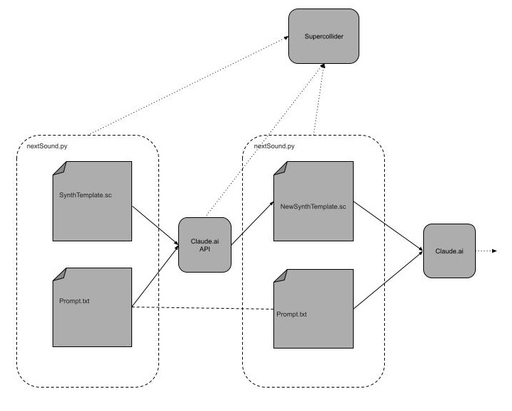
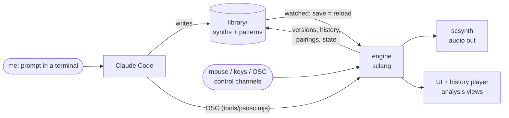
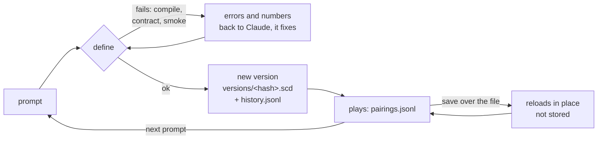

# PromptSynth
Evolving Supercollider synths using Large Language Models


### Background

- Since the launch of LLM's, I've been testing them by trying to generate [Supercollider](https://supercollider.github.io)(SC) Code. Fast forward....
[Claude](https://claude.ai) 3.5 (June 2024) was the first time succesful code was generated. Time to play!
- Began to test the depth of understanding of generating SC code
- Surprisingly successful at different prompt strategies for different outcomes... and sometimes terrible.
    - Synth construction
        - Describing a synth design with parameters
        - Model a hardware synth examples :
        [Jupiter8](https://drive.google.com/file/d/1kLJXIc4IMkB4XGaNVNmPIpQESLC0nX8_/view?usp=drive_link), 
        [MoogOne](https://drive.google.com/file/d/1nVJs2Vrq3Ig1dFBq-H3T8BDWxzX2vrT5/view?usp=drive_link), 
        [Buchla](https://drive.google.com/file/d/16biPrg_NdqQouJBjCXZD3998bJFth8Tb/view?usp=drive_link), 
        [ArpOdyssey](https://drive.google.com/file/d/1eBtU1VmAoNTex651sjrGe9ghfPwt2cEK/view?usp=drive_link)
        - Descriptive (texture, object, environment) examples :
        [Metal](https://drive.google.com/file/d/1j4aeu90Zw6Y9HyfgtfhajUw2IU8aI5lM/view?usp=drive_link), 
        [WoodBamboo](https://drive.google.com/file/d/1iGFEYUqRehFoKmd7CsPgDtE-HLmZy32E/view?usp=drive_link), 
        [Melbourne Pedestrian Crossing](https://drive.google.com/file/d/1GfH9CkV-8z7AywaxXWmyd2FNlUG4_2HH/view?usp=drive_link),
        [Raindrop](https://drive.google.com/file/d/1kNmHwaY2Vvha5fgmxy3pccB6ZsBg-B36/view?usp=drive_link), 
        [Whip Bird](https://drive.google.com/file/d/17ZW8cg7iixUhNdy2KW7bLCqi4xDrbu57/view?usp=drive_link), 
        [Forest](https://drive.google.com/file/d/1VWJ5pV1n78tGMJzQzAMb8SY5SZeR4D8T/view?usp=drive_link), 
        [Cicada](https://drive.google.com/file/d/17I0CpiqsuM6-5qYf1tVdAnvmuW4hsOGC/view?usp=drive_link), 
        [Interactive Wind](https://drive.google.com/file/d/1_eV1FP6yaCwY6lNAucM3GAFHEq2MOhNm/view?usp=drive_link)

    - Music construction examples :
    [Steve Reich](https://drive.google.com/file/d/1j7j1DL9zCZSC6ChSmomMlB9nWo4k9mR_/view?usp=drive_link), 
    [Brain Eno](https://drive.google.com/file/d/1ZQELwrDCwq7ojRjepIz-G9rywpmMj2Q3/view?usp=drive_link), 
    [Stockhausen](https://drive.google.com/file/d/1nMHKK7Q6OLKrMDuJSDCDYjV6wdrAz8Ui/view?usp=drive_link), 
    [Xenakis](https://drive.google.com/file/d/1PdD9RArZNr_spna-E1SLZ-lGmBbOOYPX/view?usp=drive_link), 
    [Deadmua5](https://drive.google.com/file/d/1ScaG9HOQbfqu-v3rlusgCy_XCH1-jQ0h/view?usp=drive_link)

- Synth construction WINS! 
- is this Vibe coding ? ([Andrej Karpathy](https://karpathy.ai)) : continue to use this in all my synth designs, from building scaffolding code to abstract descriptions.
- 2025 : The need to automate : [Claude’s API](https://docs.anthropic.com/en/release-notes/api). $ign me up!


### Prototype (now in [`legacy/`](legacy/README.md)) :

- Nov 2026 : dusted off and sorted into the three approaches it actually was, each with its own README, all running again on current Claude models :
    - [`breeding-loop/`](legacy/breeding-loop/README.md) : the loop below. Each reply becomes the next template, so the synths "breed".
    - [`anthropic-sc/`](legacy/anthropic-sc/README.md) : an API client written in sclang. Prompt from the interpreter, pull the code out of the reply, run it or append it to the document.
    - [`claude-api/`](legacy/claude-api/README.md) : the minimal one. `ask`, text back. Lost to a "bad code" commit in 2025, rescued from git history.

- Dependencies : Claude.ai API / Supercollider / Python

- Steps :
    - Create Virtual Environment
    - Install Python Requirements
    - set ```export ANTHROPIC_API_KEY=```
    - Set a prototype synth ```legacy/breeding-loop/template_0.sc```
    - Set prompt (used for every iteration) ```legacy/breeding-loop/prompt.sc```
    - Run ```legacy/breeding-loop/oscCommands.sc``` in SC
    - Run ```legacy/breeding-loop/next_sound.py``` in Python

- How it works :
    - Hacked together as a very basic work flow
    - Send Claude : ```legacy/breeding-loop/template_0.sc``` and ```legacy/breeding-loop/prompt.sc```
    - Claude returns some code : (and calls SC to load, interpret and play new Synth Definition code)
    - Each iteration is saved and loaded into SC, so every iteration is archived.

<center></center>


- Examples (video) : links to examples of script running while Supercollider interprets and generates realtime audio. 
    - [danceCelebrate.mp4](https://drive.google.com/file/d/19qMvCt93aSonaV1_mXZQaARuYupRMwS7/view?usp=drive_link) 
    - [drumMachine.mp4](https://drive.google.com/file/d/1LWSUAB4EUDUPXSK4S94LEXkyjzLBbQSC/view?usp=drive_link)
    - [drumMachineFast.mp4](https://drive.google.com/file/d/1HmJCgiGYppnBR9q9mcRYuBWiCF3GDRz6/view?usp=drive_link)
    - [fmSynth.mp4](https://drive.google.com/file/d/1Yd1a6amb7qMy3B8TJA6aYzOH0f29R_WH/view?usp=drive_link)
    - [gentleMod.mp4](https://drive.google.com/file/d/1sN7t0zp78uStLMANbRwx0W1YERji8lde/view?usp=drive_link)
    - [leadArp.mp4](https://drive.google.com/file/d/1qNb69F4l5vE-Ec6YjzOf1fa0X5KhCvBA/view?usp=drive_link)
    - [leadArpScramble.mp4](https://drive.google.com/file/d/14zDJr-e0OEX7oe1lt7s4wA0cqIVcQQ9q/view?usp=drive_link)
    - [metalicRhythm.mp4](https://drive.google.com/file/d/1iuV9SRzf1xHYuUHiB-a-6BOzVb21k9mY/view?usp=drive_link)
    - [oceanGong.mp4](https://drive.google.com/file/d/16MWoZsP0YahS_qGImLlGn7-uizE9dFdh/view?usp=drive_link)
    - [oceanWavesErrors.mp4](https://drive.google.com/file/d/1iHyJbBUWuscQgcoa622Z5YXlsnEzJdTX/view?usp=drive_link)
    - [offHarmonics.mp4](https://drive.google.com/file/d/1qw-fbiqctG4xAbpBXOboZGdoM3jNSX1h/view?usp=drive_link)
    - [pulsingSliding.mp4](https://drive.google.com/file/d/1rFWrjhsKSlXn0ITyOeY-dpGwYsQ3-Q1l/view?usp=drive_link)
    - [richPad.mp4](https://drive.google.com/file/d/1u3vp4QFLhzIT6ktJPWeoFWUbggUerDuU/view?usp=drive_link)


- Outcome so far : 
    - Very successful in creating a family of sounds that evolve over each iteration
    - Errors propagate but sometimes disappear after several iterations
    - Feels like growing synths
    - Have not improved or developed the idea further as I am too busy ‘prompting’ new ideas and listening. Is this a good thing?

### Now (2026) : the engine

The prototype grew up. Instead of a Python script calling the API in a loop, I now prompt
[Claude Code](https://claude.com/claude-code) in a terminal, and it does the work: writes the
synth or pattern, defines it in a running SuperCollider engine, checks the numbers, plays it,
fixes it. I listen and prompt again. The code is the interface : "i see with my ears".

- Dependencies : [Supercollider](https://supercollider.github.io) 3.14 / [Claude Code](https://claude.com/claude-code) / [Node](https://nodejs.org) (for the little OSC tool). No API keys, no Python.
- Optional : [FluCoMa](https://www.flucoma.org) and my AnalysisViews classes for the spectrogram / stereo views.



- How it works :
    - The **engine** (`engine/`) is sclang with an OSC API. It validates every synth (compile, contract check, a 2 s smoke test for NaNs, silence, clipping), then stores it.
    - Every **version is content-hashed** and kept, with the prompt that made it. Each prompt adds to the chain, so a synth's history reads like the conversation:

      > hollow log with a piano string decay and a small amount of vibrato at the tail end... / add a pad synth layer / all synths should have env parameters / add inharmonics to make the wood sound more like a metal drum

    - **Pairings** log which pattern version played on which synth version, and when.
    - **Save over a file** while it plays and it reloads (refining, not a new version).
    - **Patterns** play and stop on the next beat, and swap on the pattern's bar line. Any key can be overridden live (`/ps/pattern/set`) without saving.
    - **Control channels** : mouse, keys or any OSC value, mapped onto a synth param with a range and warp. The mapping is saved, the movement isn't. Plus **fx** inserted on the mix (a small reverb so far) and **recording** to WAV.
    - **Rules the LLM has to follow** live in [`docs/decisions.md`](docs/decisions.md) and [`docs/cheatsheet.md`](docs/cheatsheet.md) : never read the mouse inside a synth (map a control channel onto a param instead), every synth has envelope params, nothing may block the interpreter (the pattern clock shares it)...



- Running it :
    - `tools/start-engine.sh` starts the engine headless, post window in the terminal. `--views` also opens the analysis views (mel spectrogram, bands, MFCCs, stereo field).
    - Evaluate `engine/ui.scd` for the UI : synths and patterns, each one's trail of versions, an event log, meters, mute, CPU / nodes, and a **history player** that steps back through what played.
    - Then just talk to Claude Code in the repo. Details : [`engine/README.md`](engine/README.md), plan : [`docs/plan.md`](docs/plan.md).

- Recent moves :
    - **Speed over accuracy.** What matters is the time from prompt to sound, not a perfect first try. I'd rather hear it wrong fast and say what to change.
    - A **cheat sheet** ([`docs/cheatsheet.md`](docs/cheatsheet.md)) : one page with everything needed to write a synth or pattern, so a session starts writing straight away instead of reading all the docs first.
    - **Patterns pitch with `\note`**, not `\midinote`, so `\octave` and `\root` work. Every pattern converted, pitch for pitch.
    - **UI 2** (in progress, `tools/start-engine.sh --ui`) : the other side of the conversation. Claude Code's hooks send what it's doing (prompt, reading, writing, running...) to a window next to what's playing.
    - **Web UI, stage 1** (in progress, `web/`) : a tiny local Node bridge, no dependencies, serving one page in the browser. It shows what's playing, what Claude Code is doing and each item's trail, with play / stop / solo. The page is still to come; the SC windows stay until it's as good.

- Some of what came out of the sessions (all in `library/`) :
    - Synths : warmDrone (phase distortion, air, a wooden knock), hollowLog (string + log + pad, then a metal drum), glass with a whisper attack, a Model D style fatMoog, an 808 hat, a dubstep growlBass, harpRecorder (harpsichord + recorder), swimFloat (meditation / floating), birdCall and an Australian magpie, a Minimoog-style moogBass, fuzzHollow (fuzzy warm hollow, with sparkle and verb) and its 4x warmer lead, and a smallVerb fx.
    - Patterns : Bach's C major prelude ([WTC I](https://en.wikipedia.org/wiki/Prelude_and_Fugue_in_C_major,_BWV_846)), Vivaldi's [Spring](https://en.wikipedia.org/wiki/The_Four_Seasons_(Vivaldi)) (first 32 bars, notes from the [Mutopia Project](https://www.mutopiaproject.org/cgibin/piece-info.cgi?id=301) LilyPond, CC BY-SA), deadmau5-style progressive house, an evolving pattern that never settles, arpeggios of a very famous IV-V-iii-vi, and Debussy's [Clair de lune](https://en.wikipedia.org/wiki/Suite_bergamasque#3._Clair_de_lune) (first 32 bars: the melody on the fuzzHollow lead, the chords as slow arpeggios underneath, from the Mutopia Project MIDI, public domain).
    - The magpie went through research first : the syrinx has two independent voices and the "warble" is frequencies beating against each other, not an LFO ([Suthers, Wild & Kaplan 2011](https://doi.org/10.1007/s00359-010-0585-6)).

- Outcome so far :
    - The loop is now a conversation : prompt, listen, refine, and every defined version is kept with its prompt.
    - Claude still gets it wrong (a mono "stereo" bass, gain staging that clipped, the odd syntax slip), but it diagnoses and fixes from the numbers and from what I hear.
    - It also builds the tools : the engine, tests (135 of them), the watcher, the UI, the history player were all made the same way.
    - Saving over files is the fastest way to refine, but those edits aren't stored yet, so the history player can't replay them.

### Future : 

- ~~Build more robust ‘play ground’ for testing LLM’s, workflows and prompting strategies.~~ The engine.
- ~~Archive outputs : code, audio, error, analysis.~~ Versions, prompts, pairings and failures are kept; recording to WAV is in.
- [MCP](https://modelcontextprotocol.io) (Model Context Protocol) and prompting from inside the SC window : parked. The terminal is better than I expected.
- **Variants and staging** (next up, [plan](docs/plan.md)) : while I listen, background agents write variations ("darker", "more rhythmic"). They wait in staging until I `/try`, `/keep` or `/drop` them, all typed in the terminal, no GUI. A footer under the prompt shows what's writing, ready or failed. The breeding loop again, but in parallel and I choose.
- Different models for different jobs : Opus writes and tweaks, Sonnet does the variants, Haiku looks things up. Faster, and cheaper.
- MIDI files to patterns : a script converts the notes, Claude does the music part (which section, quantise, which synth plays what).
- Store every save, so the history player can replay the refining too.
- Analysis as Claude's ears : measure real recordings (e.g. magpies, with [FluCoMa](https://www.flucoma.org)) and turn them into synth parameters.
- MIDI in, so a note can play a call or a chord.
- Automate automate automate : batch process all of it.
- Local model version.
- Looking for collaborators :  ideas, techniques, code
- Big dream : local model running on a RPI that generates continuous soundscape with prompting (text for now) that guides the composition.
    
